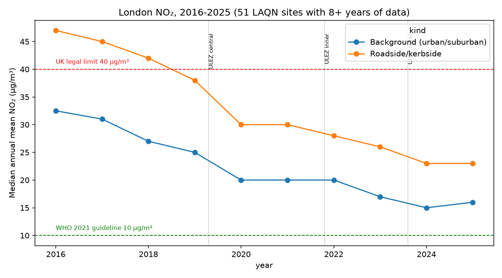
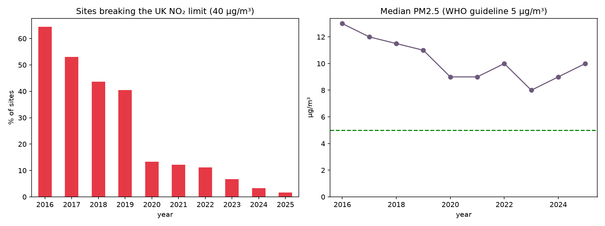
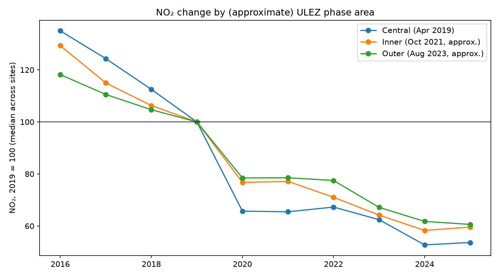
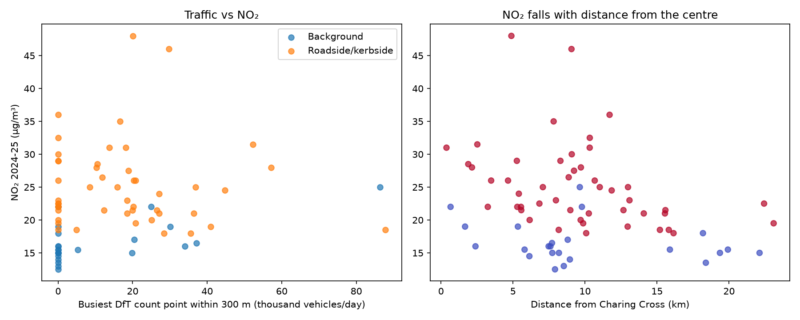
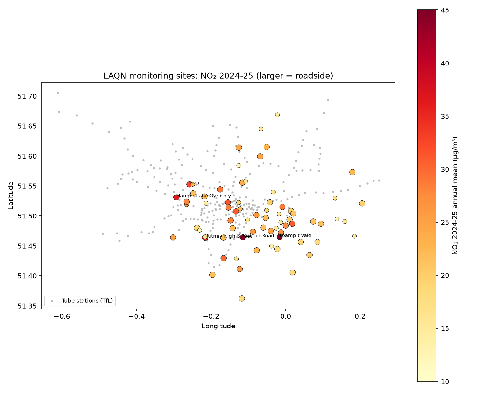

# London air quality and transport: NO₂, ULEZ and traffic exposure, 2016-2025

A geospatial analysis of London's air. It combines **London Air (LAQN)** monitoring data, **DfT road traffic counts** and **TfL** bus stop and
tube station locations to show how pollution has changed, how it differs between roadside and background sites, and what transport
factors explain it. The project includes a Streamlit map.

Author: Anthony Adusei-Poku ([@anthony07-max](https://github.com/anthony07-max))



## Key findings
1. **NO₂ has roughly halved since 2016.** Across 51 sites with long records, median roadside NO₂ fell from 47 to 23 µg/m³ and background NO₂ from 32.5 to 16 µg/m³ (2016 to 2025).
2. **London almost meets the legal limit now.** The share of LAQN sites over the UK annual limit (40 µg/m³) dropped from **64.5% in 2016 to 1.7% in 2025**.
   Brixton Road (48) and Lewisham Loampit Vale (46) were the worst in 2024-25. But **every site is still above the WHO 2021 guideline** of 10 µg/m³,
   and every PM2.5 site is above the WHO guideline of 5 µg/m³ (median 8-10 µg/m³ since 2020).
3. **The biggest falls came in the zones that got the ULEZ first.** From 2019 to 2024 the median site changed by −47% in central London (only 3 sites), −42% in inner London and
   −38% in outer London. Outer London's fall sped up after 2022 (index 77.5 → 61.8 by 2024), in line with the August 2023 expansion. COVID-19 (2020),
   fleet renewal and other policies all overlap, so this is descriptive, not a causal estimate.
4. **Site type matters most, and the bus network acts as a proxy for busy streets.** In a robust OLS on 71 sites (R² 0.51), roadside and kerbside sites run about **7.8 µg/m³ higher**,
   and each extra bus stop within 300 m adds about **0.47 µg/m³** (p = 0.04). Traffic from the nearest DfT count point was *not* significant.
   That's because count points are sparse and often not on the monitored street, which is a useful lesson in how much measurement matters.

| | |
|---|---|
|  |  |
|  |  |

## Method and caveats
- Annual means come from the LAQN API. Only site-years with **at least 75% data capture** are kept. The trend uses sites with at least 8 of 10 years of data.
- **ULEZ areas are approximated by distance from Charing Cross** (under 3 km central, 3-9 km inner, over 9 km outer), not the official boundaries.
  Treat the phase comparison as indicative.
- Transport exposure per site uses the busiest DfT count point within 300 m (latest year's AADF), TfL bus stops within 300 m and tube stations within 800 m.
- The number of LAQN sites changes over time (some close and some open), so compliance shares are based on whichever sites reported each year.

## Data sources
- [London Air Quality Network (LAQN) API](https://api.erg.ic.ac.uk/AirQuality/help), Environmental Research Group, Imperial College London ([londonair.org.uk](https://www.londonair.org.uk)).
- [DfT road traffic statistics, AADF by region (London)](https://roadtraffic.dft.gov.uk/downloads), under the Open Government Licence.
- [TfL Unified API, StopPoint](https://api.tfl.gov.uk/) (bus stops and tube stations). Powered by TfL Open Data, which contains OS data © Crown copyright and database rights.
- [ULEZ dates](https://tfl.gov.uk/modes/driving/ultra-low-emission-zone): central April 2019, inner October 2021, London-wide August 2023.

## How to run
```bash
python -m venv .venv && source .venv/bin/activate
pip install -r requirements.txt
bash run_pipeline.sh      # about 1 minute
streamlit run app/streamlit_app.py
```
